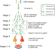
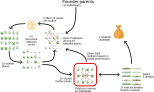
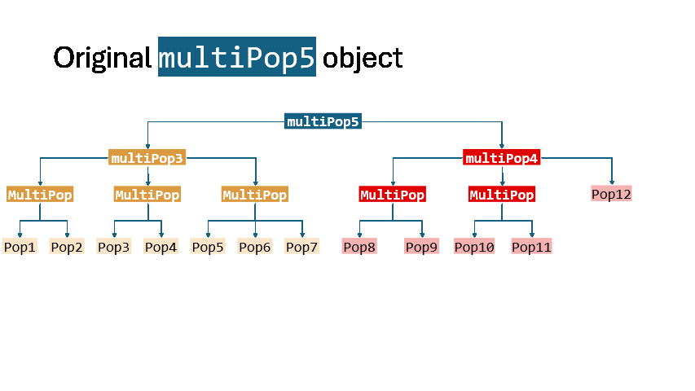
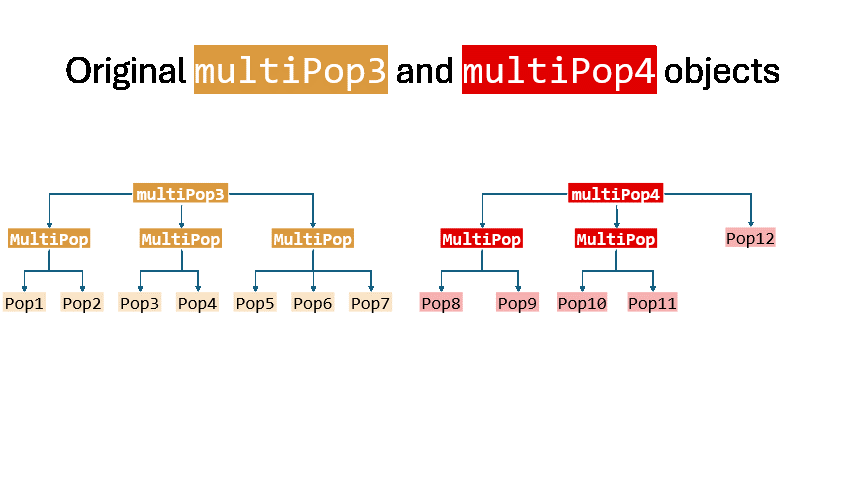

```{r setup, include = FALSE}
knitr::opts_chunk$set(
  collapse = TRUE,
  comment = "#>",
  fig.align = "center"
)

library(AlphaSimR)
```

## Introduction

`AlphaSimR` treats a `Pop`-class object as the basic unit of simulation. In many breeding programs, however, individuals are managed, evaluated, and selected as members of a larger unit such as a family, sward, tank, cage, or colony. The `MultiPop` class represents these structured populations while preserving relationships among their component populations.

A `MultiPop` can contain `Pop` objects, other `MultiPop` objects, or a combination of both. This makes it possible to represent nested breeding structures and to apply existing AlphaSimR operations recursively within those structures.

This vignette introduces `MultiPop` through two practical examples: pedigree selection in wheat and recurrent selection followed by half-sib family evaluation in forage breeding. It assumes familiarity with the basic AlphaSimR workflow. For more information, see the following:

- `vignette("AlphaSimR")` for founder populations, simulation parameters, crossing, and selection

- `vignette("Genome")` for an overview of genomes, genes, alleles, loci, genotypes, and haplotypes

- `vignette("traits")` for trait specification

The examples focus on workflows that are especially useful in population breeding: constructing and splitting structured populations, applying operations recursively, summarizing values within and across population levels, selecting population units, and simplifying or merging nested structures. The code is intended to be read and run in order.

## Quick start

### Creating a `MultiPop`

A `MultiPop` can be created in two main ways:

1. `newMultiPop()` combines existing `Pop` or `MultiPop` objects.
2. `splitPop()` partitions one `Pop` according to one or more grouping
   variables or functions.

The structure can later be simplified with `flattenMultiPop()` or `mergeMultiPops()`. Flattening changes the nesting depth while retaining the component `Pop` objects. Merging combines component populations; the `level` argument controls how much of the hierarchy is retained.

We begin by creating founder haplotypes, a trait, and a population of individuals.

```{r quick-start}
set.seed(1234)
# Generate initial haplotypes
founderPop = quickHaplo(nInd = 20, nChr = 1, segSites = 10)
# Set simulation parameters
SP = SimParam$new(founderPop)
SP$addTraitA(nQtlPerChr = 10)
SP$setVarE(h2 = 0.5)
# Create a population of individuals
pop = newPop(founderPop, simParam = SP)
```

`newMultiPop()` combines existing populations. Names can be supplied when the object is constructed, and `MultiPop` objects can be nested.

```{r new-multipop-quick-start}
# Combine existing populations into a MultiPop
mp = newMultiPop(
  pop[1:4],
  pop[5:8],
  pop[9:12],
  pop[13:16],
  pop[17:20]
)
mp

# Assign population names
mp_named = newMultiPop(
  pop1 = pop[1:4],
  pop2 = pop[5:8],
  pop3 = pop[9:12],
  pop4 = pop[13:16],
  pop5 = pop[17:20]
)
mp_named

# MultiPop objects can be nested
mp_nested = newMultiPop(
  group1 = pop[1:2],
  group2 = newMultiPop(
    subgroup1 = pop[3:4],
    subgroup2 = newMultiPop(pop1 = pop[5:7], pop2 = pop[8:12])
  )
)
mp_nested
```

The list-like interface can inspect or replace components by position or name. Single brackets (`[]`) retain a `MultiPop`, whereas double brackets (`[[]]`) extract one child object.

```{r access-components-quick-start}
mp_named[1:2]
mp_named[[1]]
mp_named[["pop1"]]
mp_named$pop1

# Replace one element in the MultiPop
mp_named[["pop1"]] = pop[17:20]
mp_named
```

`unnameMultiPop()` can remove names recursively or at a specified level.

```{r unname-multipop-quick-start}
unnameMultiPop(mp_nested)
unnameMultiPop(mp_nested, level = 2)
```

### Splitting a population

`splitPop()` is useful when grouping information is stored as a vector, data frame, or user-defined function.

```{r split-pop-quick-start}
# Using a vector to split a population
family = rep(c("A", "B"), length.out = nInd(pop))
mp_split1 = splitPop(pop, by = family)
mp_split1

# Using a data frame. Each column defines one nesting level
grouping = data.frame(
  family = sample(LETTERS[1:3], nInd(pop), replace = TRUE),
  replicate = sample(letters[4:5], nInd(pop), replace = TRUE),
  row.names = pop@id
)
mp_split2 = splitPop(pop, by = grouping)
mp_split2

# Using a function
grouping_fun = function(x) {
  value = drop(pheno(x))
  ifelse(value > mean(value), "aboveMean", "belowMean")
}
mp_split3 = splitPop(pop, by = grouping_fun)
mp_split3

# Using a list of vectors and functions.
mp_split4 = splitPop(pop, by = list(family, grouping_fun))
mp_split4
```

For a data frame, each column defines one nesting level. Row names can be used to align grouping records with individual IDs. A list applies grouping specifications sequentially.

### Flattening and merging

`flattenMultiPop()` removes intermediate levels while retaining the component `Pop` objects.

```{r flatten-quick-start}
# Flatten the whole structure
flattenMultiPop(mp_nested)

# Or flatten up until level 2
flattenMultiPop(mp_nested, level = 2)

# Duplicate names are dropped
flattenMultiPop(mp_split2)

# To avoid dropping names, "concatenate" them
flattenMultiPop(mp_split2, preserveNames = "concatenate")
```

`mergeMultiPops()` combines component populations. With the default `level = 0`, all populations are merged into one `Pop`. Larger values retain progressively more of the hierarchy.

```{r merge-quick-start}
# All population are merged into one Pop
mergeMultiPops(mp_split4)

# Use `level` to retain the hierarchy
mergeMultiPops(mp_split4, level = 1)

# Merge two or more objects. `level` controls how merging retains the structure
mergeMultiPops(mp_nested, mp_split4, level = 3)
```

## Why use a `MultiPop`?

Many breeding programs have a hierarchy between an individual and the complete breeding population. Selection may act on families in plant breeding, tanks in aquaculture, or colonies in insect breeding. A `MultiPop` preserves this hierarchy, making it possible to apply operations within groups, compare groups, and retain the origin of each component.

The examples below show how this representation can replace explicit list manipulation while keeping the biological structure of the breeding program visible.

## Revisiting pedigree breeding in wheat

We previously showed how to implement a hypothetical wheat line-breeding program using the pedigree method [@bancic2025Plant]. This method involves specific parental crosses followed by repeated family and within-family selection until lines are sufficiently inbred for multi-environment trials. Parent-progeny information is retained to help preserve variation among lines and produce new crosses.

```{r wheat-scheme, echo=FALSE, out.width="100%", fig.cap="A simplified wheat breeding scheme implementing the pedigree breeding method."}

```

### Stages 1 and 2

We create founder haplotypes and a trait representing grain yield. The trait includes additive and genotype-by-environment effects. Founder parents are crossed to produce 40 F1 individuals.

```{r wheat-stage-1, eval=FALSE}
# Stage 1
# Generate initial haplotypes
founderPop = runMacs(
  nInd = 20,
  nChr = 1,
  segSites = 1e3,
  inbred = TRUE,
  species = "WHEAT"
)

# Set simulation parameters
SP = SimParam$new(founderPop)
# Add one trait representing Grain Yield
SP$addTraitAG(
  nQtlPerChr = 1e3,
  mean = 1,
  var = 1,
  varEnv = 1e-6,
  varGxE = 2,
  name = "Yield"
)

# Set p value for the environmental covariate used by GxE trait
p = runif(1)

# Create founder parents and cross to produce F1
Parents = newPop(founderPop, simParam = SP)
F1 = randCross(Parents, nCrosses = 40)
```

In Stage 2, each F1 individual is self-pollinated to produce a family of 250 F2 individuals. We phenotype each family and select 25 individuals from each family.

Without `MultiPop`, this requires an explicit list and loop:

```{r wheat-stage-2-non-multipop, eval = FALSE}
# Stage 2
# Create an empty list to keep crosses separate
F2 = vector("list", 40)
# Loop over crosses
for(i in 1:40){
  # Self each F1 to produce 250 F2 individuals
  F2_i = self(F1[i], nProgeny = 250)
  # Phenotype the family of 250 F2 individuals
  F2_i = setPheno(F2_i, varE = 4, reps = 4/19, p = p)
  # Select 25/250 F2 for the next stage
  F2[[i]] = selectInd(F2_i, nInd = 25)
}
```

With `MultiPop`, each F1 individual becomes a population unit and the operations are applied recursively to every terminal `Pop`.

```{r wheat-stage-2-multipop, eval = FALSE}
# Stage 2
# Split the F1 by individual
F1 = splitPop(F1, by = F1@id)
# Self each F1 to produce 250 F2 individuals
F2 = self(F1, nProgeny = 250)
# Phenotype all families of 250 F2 individuals
F2 = setPheno(F2, varE = 4, reps = 4/19, p = p)
# Select 25/250 F2 individuals per family
F2 = selectInd(F2, nInd = 25)
```

### Stages 3 to 5: selecting rows within families

In each subsequent stage, every selected individual is self-pollinated to produce 20 progeny. The progeny are planted in **rows**, and the row is the evaluation unit. We simulate individual phenotypes and use their mean as the row phenotype. We then select the best 10 rows per family and the best 4 individuals within each selected row.

Stage 3 is written as follows:

<div style="display: flex; gap: 10px;">

<div style="flex: 50%;">

**Without MultiPop**
```{r, wheat-stage-3-non-multipop, eval = FALSE}
# Stage 3
# Create an empty list to keep families separate
F3 = vector("list",40)
# Loop over families
for(i in 1:40){
  # Number of rows per family
  n = nInd(F2[[i]])
  # Create an empty list to keep rows separate
  F3rows = vector("list",n)
  # Create an empty vector of row phenotypes
  F3pheno = numeric(n)
  # Loop over rows
  for(j in 1:n){
    # Self each F2 to produce 20 F3 individuals
    F3rows[[j]] = self(F2[[i]][j], nProgeny=20)
    # Phenotype the row of F3 individuals
    F3rows[[j]] = setPheno(F3rows[[j]], varE=4,
                           reps=4/19, p=p)
    # Calculate the mean phenotypic value per row
    F3pheno[j] = meanP(F3rows[[j]])
  }
  # Select 10 F3 rows per family
  take = order(F3pheno,decreasing=TRUE)[1:10]
  F3rows = F3rows[take]
  # Select 4 plants per selected F3 row
  for(j in 1:10){
    F3rows[[j]] = selectInd(F3rows[[j]], nInd=4)
  }
  # Merge all 4×10 selected plants into a single Pop
  F3[[i]] = mergePops(F3rows)
}
```

</div>

<div style="flex: 50%;">

**With MultiPop**

```{r, wheat-stage-3-multipop, eval = FALSE}
# Stage 3
# Split each F2 family by individual
F2 = splitPop(F2, by = function(x) x@id)
# Self each F2 to produce 20 F3 individuals
F3 = self(F2, nProgeny=20)
# Phenotype the row of F3 individuals
F3 = setPheno(F3, varE=4, reps=4/19, p=p)
# Select 10 F3 rows per family using mean pheno values
F3 = selectPop(F3, nPop=10, level=2, use='pheno', FUN=mean)
# Select 4 plants per selected F3 row
F3 = selectInd(F3, nInd = 4)
# Merge all 4×10 selected plants into a single Pop
F3 = mergeMultiPops(F3, level = 1)
```

</div>

</div>

Here, `selectPop(level = 2)` selects rows within each family, while `selectInd()` selects individuals within each selected row. The hierarchy therefore corresponds directly to the breeding program: families contain rows, and rows contain individuals.

The same pattern can be repeated for stages 4 and 5:

<div style="display: flex; gap: 10px;">

<div style="flex: 50%;">

**Without MultiPop**

```{r, wheat-stage-4-non-multipop, eval = FALSE}
# Stage 4
# Create an empty list to keep families separate
F4 = vector("list",40)
# Loop over families
for(i in 1:40){
  # Number of rows per family
  n = nInd(F3[[i]])
  # Create an empty list to keep rows separate
  F4rows = vector("list",n)
  # Create an empty vector of row phenotypes
  F4pheno = numeric(n)
  # Loop over rows
  for(j in 1:n){
    # Self each F3 to produce 20 F4 individuals
    F4rows[[j]] = self(F3[[i]][j], nProgeny=20)
    # Phenotype the row of F4 individuals
    F4rows[[j]] = setPheno(F4rows[[j]], varE=4,
                           reps=4/19, p=p)
    # Calculate the mean phenotypic value per row
    F4pheno[j] = meanP(F4rows[[j]])
  }
  # Select 10 F4 rows per family
  take = order(F4pheno,decreasing=TRUE)[1:10]
  F4rows = F4rows[take]
  # Select 4 plants per selected F4 row
  for(j in 1:10){
    F4rows[[j]] = selectInd(F4rows[[j]],4)
  }
  # Merge all 4×10 selected plants into a single Pop
  F4[[i]] = mergePops(F4rows)
}
```

</div>

<div style="flex: 50%;">

**With MultiPop**

```{r, wheat-stage-4-multipop, eval = FALSE}
# Stage 4
# Split each F3 family by individual
F3 = splitPop(F3, by = function(x) x@id)
# Self each F3 to produce 20 F4 individuals
F4 = self(F3, nProgeny=20)
# Phenotype the row of F4 individuals
F4 = setPheno(F4, varE=4, reps=4/19, p=p)
# Select 10 F4 rows per family using mean pheno values
F4 = selectPop(F4, nPop=10, level=2, use='pheno', FUN=mean)
# Select 4 plants per selected F4 row
F4 = selectInd(F4, nInd=4)
# Merge all 4×10 selected plants into a single Pop
F4 = mergeMultiPops(F4, level=1)
```

</div>

</div>

<div style="display: flex; gap: 10px;">

<div style="flex: 50%;">

**Without MultiPop**

```{r, wheat-stage-5-non-multipop, eval = FALSE}
# Stage 5
# Create an empty list to keep families separate
F5 = vector("list",40)
# Loop over families
for(i in 1:40){
  # Number of rows per family
  n = nInd(F4[[i]])
  # Create an empty list to keep rows separate
  F5rows = vector("list",n)
  # Create an empty vector of row phenotypes
  F5pheno = numeric(n)
  # Loop over rows
  for(j in 1:n){
    # Self each F4 to produce 20 F5 individuals
    F5rows[[j]] = self(F4[[i]][j], nProgeny=20)
    # Phenotype the row of 20 F5 individuals
    F5rows[[j]] = setPheno(F5rows[[j]], varE=4,
                           reps=4/19, p=p)
    # Calculate the mean phenotypic value per row
    F5pheno[j] = meanP(F5rows[[j]])
  }
  # Select 10 F5 rows per family
  take = order(F5pheno,decreasing=TRUE)[1:10]
  F5rows = F5rows[take]
  # Select 4 plants per selected F5 row
  for(j in 1:10){
    F5rows[[j]] = selectInd(F5rows[[j]],4)
  }
  # Merge all 4×10 selected plants into a single Pop
  F5[[i]] = mergePops(F5rows)
}
```

</div>

<div style="flex: 50%;">

**With MultiPop**

```{r, wheat-stage-5-multipop, eval = FALSE}
# Stage 5
# Split each F4 family by individual
F4 = splitPop(F4, by = function(x) x@id)
# Self each F4 to produce 20 F5 individuals
F5 = self(F4, nProgeny=20)
# Phenotype the row of F5 individuals
F5 = setPheno(F5, varE=4, reps=4/19, p=p)
# Select 10 F5 rows per family using mean pheno values
F5 = selectPop(F5, nPop=10, level=2, use='pheno', FUN=mean)
# Select 4 plants per selected F5 row
F5 = selectInd(F5, nInd=4)
# Merge all 4×10 selected plants into a single Pop
F5 = mergeMultiPops(F5, level=1)
```

</div>

</div>

### Stage 6: selecting inbred lines

At Stage 6, repeated self-pollination has made the plants within a row approximately homogeneous. We select the best four rows per family and randomly retain one plant from each row as the simulated line.

<div style="display: flex; gap: 10px;">

<div style="flex: 50%;">

**Without MultiPop**

```{r, wheat-stage-6-non-multipop, eval = FALSE}
# Stage 6
# Create an empty list to keep families separate
F6 = vector("list",40)
# Loop over families
for(i in 1:40){ 
  # Number of rows per family
  n = nInd(F5[[i]])
  # Create an empty list to keep rows separate
  F6lines = vector("list",n)
  # Create an empty vector of row phenotypes
  F6pheno = numeric(n)
  # Loop over rows
  for(j in 1:n){
    # Self each F5 to produce 20 F6 individuals
    F6lines[[j]] = self(F5[[i]][j], nProgeny=20)
    # Phenotype the row of F6 individuals
    F6lines[[j]] = setPheno(F6lines[[j]], varE=4,
                           reps=4/19, p=p)
    # Calculate the mean phenotypic value per row
    F6pheno[j] = meanP(F6lines[[j]])
  }
  # Select 4 F6 rows per family
  take = order(F6pheno,decreasing=TRUE)[1:4]
  F6lines = F6lines[take]
  # Randomly select 1 plant per F6 row.
  for(j in 1:4){
    F6lines[[j]] = selectInd(F6lines[[j]], 1, use='rand')
  }
  # Merge all 4 selected plants into a single Pop
  F6[[i]] = mergePops(F6lines)
}
# Merge all 4×40 selected plants into a single Pop
F6 = mergePops(F6)
```

</div>

<div style="flex: 50%;">

**With MultiPop**

```{r, wheat-stage-6-multipop, eval = FALSE}
# Stage 6
# Split each F5 family by individual
F5 = splitPop(F5, by=function(x) x@id)
# Self each F5 to produce 20 F6 individuals
F6 = self(F5, nProgeny=20)
# Phenotype the row of F6 individuals
F6 = setPheno(F6, varE=4, reps=4/9, p=p)
# Select 4 F6 rows per family
F6 = selectPop(F6, nPop=4, level=2, FUN=mean)
# Randomly select 1 plant per F6 row.
F6 = selectInd(F6, nInd=1, use='rand')
# Merge all 4×40 selected plants into a single Pop
F6 = mergeMultiPops(F6)
```

</div>

</div>

The `MultiPop` structure can now be removed because each selected line is treated as an individual in the yield trials.

### Stages 7 to 9: yield trials

The selected lines are finally evaluated and selected in preliminary, advanced, and elite yield trials (PYT, AYT, and EYT).

```{r wheat-yield-trials, eval = FALSE}
# Stage 7
PYT = selectInd(F6, nInd = 100)
PYT = setPheno(PYT, varE = 4, reps = 1)

# Stage 8
AYT = selectInd(PYT, nInd = 50)
AYT = setPheno(AYT, varE = 4, reps = 4)

# Stage 9
EYT = selectInd(AYT, nInd = 10)
EYT = setPheno(EYT, varE = 4, reps = 8)
```

## A forage-breeding example

This example represents a forage-breeding program in which individual plants are selected during recurrent selection, whereas half-sib families and field replicates become the evaluation units later in the program.

```{r forage-scheme, echo=FALSE, out.width="100%", fig.cap="A simplified forage-breeding scheme used in this example."}

```

### Founder population and traits

`Vigor` is evaluated on individual plants during recurrent selection, whereas `Biomass` is evaluated later on **swards** (plots containing a population of related plants). The two traits are genetically correlated and include additive and dominance effects.

```{r forage-founders}
set.seed(1234)

# Generate initial haplotypes
founderPop = runMacs(
  nInd = 10,
  nChr = 7,
  segSites = 1e3,
  inbred = FALSE,
  ploidy = 2L,
  species = "GENERIC"
)

# Set simulation parameters
SP = SimParam$new(founderPop)

# Set trait mean, variance, genetic correlation and heritability
traitMean = c(Vigor = 0, Biomass = 0)
traitVar = c(Vigor = 1, Biomass = 1)
genCor = 0.5
corA = matrix(c(1, genCor, genCor, 1), nrow = 2)
h2 = c(Vigor = 0.4, Biomass = 0.4)

# Simulate Vigor and Biomass
SP$addTraitAD(
  nQtlPerChr = 1e3,
  mean = traitMean,
  var = traitVar,
  corA = corA,
  meanDD = 0.3,
  varDD = 0.1,
  name = names(h2)
)
```

### Recurrent selection on individual plants

Founder parents are open-pollinated to create the first nursery. Each seed is treated as an individual evaluation unit.

```{r forage-cycle-1}
# Create founder individuals
parents = newPop(founderPop, simParam = SP)

# Open-pollinate 10 founder parents
ny1 = selectOP(
  parents,
  nInd = 10,
  use = "rand",
  nSeeds = 20,
  pollenControl = TRUE
)

# Phenotype the first nursery
ny1 = setPheno(ny1, h2 = h2["Vigor"], traits = "Vigor", reps = 4/19)
```

We select one individual from each maternal half-sib family and open-pollinate those plants to form the next nursery.

```{r forage-cycle-2}
# Select one individual from each half-sib family
ny1_candidates = selectWithinFam(
  ny1,
  nInd = 1,
  trait = "Vigor",
  use = "pheno",
  famType = "F",
  returnPop = FALSE
)

# Open-pollinate selected plants
ny2 = selectOP(
  ny1,
  candidates = ny1_candidates,
  nInd = 10,
  nSeeds = 20,
  pollenControl = TRUE
)

# Phenotype the second nursery
ny2 = setPheno(ny2, h2 = h2["Vigor"], traits = "Vigor", reps = 4/19)

# Select one individual from each half-sib family
ny2_candidates = selectWithinFam(
  ny2,
  nInd = 1,
  trait = "Vigor",
  use = "pheno",
  famType = "F",
  returnPop = FALSE
)

# Open-pollinate selected plants
ny3 = selectOP(
  ny2,
  candidates = ny2_candidates,
  nInd = 10,
  nSeeds = 20,
  pollenControl = TRUE
)

# Phenotype the third nursery
ny3 = setPheno(ny3, h2 = h2["Vigor"], traits = "Vigor", reps = 4/19)
```

After one final round of individual selection, the selected mothers are cloned and open-pollinated to produce the first synthetic generation (Syn-1). This process is also known as a _polycross_ in forage breeding. Increasing `nSeeds` approximates cloning the selected mothers to increase seed production.

```{r forage-syn1}
# Final round of individual selection
ny3_candidates = selectWithinFam(
  ny3,
  nInd = 1,
  trait = "Vigor",
  use = "pheno",
  famType = "F",
  returnPop = FALSE
)

# Open pollination of cloned mothers
syn1 = selectOP(
  ny3,
  candidates = ny3_candidates,
  nInd = 10,
  nSeeds = 80,
  pollenControl = TRUE
)
```

### Evaluating half-sib families as populations

Seed from each mother is sown in a **sward**, and each maternal half-sib family is treated as one evaluation unit. `splitPop()` creates one terminal `Pop` per maternal family.

```{r forage-half-sibs}
# Split `syn1` by maternal half-sib family
syn1_HS = splitPop(syn1, by = syn1@mother)

# Phenotype `Biomass` in swards of half-sib families
syn1_HS = setPheno(syn1_HS, h2 = h2["Biomass"], traits = "Biomass", reps = 4/19)
syn1_HS
```

When a `MultiPop` is passed to `meanP()`, the function calculates mean phenotypic values for each terminal `Pop`. With `simplify = TRUE`, the results are returned as a matrix with a `source` attribute identifying the population from which each row originated.

```{r forage-population-means}
meanP(syn1_HS, simplify = TRUE)
```

The more general `calcPopValue()` function applies a user-supplied operation to every terminal `Pop`.

```{r forage-calc-pop-value}
calcPopValue(
  syn1_HS,
  FUN = function(x) colMeans(pheno(x)),
  simplify = TRUE,
  level = 1
)
```

> **Tip:**  You can collect and/or calculate other population-level values from a MultiPop object passing your own function `FUN` to `calcPopValue()`.

We can select the five best half-sib families using their mean biomass. `selectPop()` ranks the terminal populations using `FUN = mean`.

```{r forage-select-families}
syn1_HS_candidates = selectPop(
  syn1_HS,
  nPop = 5,
  trait = "Biomass",
  use = "pheno",
  FUN = mean
)

syn1_HS_candidates
```

The selected families are merged and intermated. The example uses 2,000 random crosses and one progeny per cross as a manageable approximation of bulk seed production.

```{r forage-syn2}
syn1_candidates = mergeMultiPops(syn1_HS_candidates)
syn2 = randCross(
  syn1_candidates,
  nCrosses = 2000,
  nProgeny = 1,
  simParam = SP
)
```

In addition, the names of `syn1_HS_candidates` correspond to the IDs of the selected mothers. They can therefore be used to start a new recurrent-selection cycle.

```{r forage-new-cycle}
names(syn1_HS_candidates)
ny1 = selectOP(
  ny3,
  candidates = names(syn1_HS_candidates),
  nInd = 5,
  nSeeds = 20,
  pollenControl = TRUE
)
```

### Nested `MultiPop` objects

Field testing may add another level to the hierarchy. Seed from each half-sib family can be divided among several field replicates. Each replicate is sown in a sward and contains genetically related but distinct individuals.

```{r forage-replicates}
# Split the population, first by half-sib family,
#   then by replicate
syn1_HS_reps = splitPop(
  syn1,
  by = list(
    syn1@mother,
    function(x) {
      sample(paste0("R", 1:3), size = nInd(x), replace = TRUE)
    }
  )
)

# Phenotype `Biomass` in swards of replicates
syn1_HS_reps = setPheno(
  syn1_HS_reps,
  h2 = h2["Biomass"],
  traits = "Biomass",
  reps = 4/19,
  simParam = SP
)
syn1_HS_reps
```

At `level = 1`, the direct children are family-level `MultiPop` objects, so `selectPop()` cannot select them:

```{r select-pop-error, error = TRUE}
selectPop(
  syn1_HS_reps,
  nPop = 5,
  level = 1,
  trait = "Biomass",
  use = "pheno",
  FUN = mean
)
```

At `level = 2`, `selectPop()` reaches replicate `Pop` objects. Selection is performed separately within each family. Because each family contains only three replicates, requesting five produces a warning and returns three replicates per family.

```{r select-replicates}
selectPop(
  syn1_HS_reps,
  nPop = 5,
  level = 2,
  trait = "Biomass",
  use = "pheno",
  FUN = mean
)
```

To select families, first aggregate replicate summaries within each family. `meanPPop()` performs an unweighted mean of means, giving each replicate equal weight regardless of its number of individuals.

```{r family-means}
meanPPop(syn1_HS_reps, level = 1)
```

`calcPopSummary()` separates the two operations: `withinPopFUN` summarizes individuals within each terminal `Pop`, and `acrossPopFUN` aggregates those summaries through the hierarchy.

```{r family-response}
calcPopSummary(
  syn1_HS_reps,
  withinPopFUN = function(p) {
    colMeans(pheno(p)[, "Biomass", drop = FALSE])
  },
  acrossPopFUN = colMeans,
  level = 1
)
```

> **Tip:**  You can _summarize_ and _aggregate_ other population-level values from a MultiPop object passing your own functions to `calcPopSummary()`.

`selectMultiPop()` uses these within- and across-population functions to select structured units directly.

```{r select-families-nested}
syn1_HS_reps_candidates = selectMultiPop(
  syn1_HS_reps,
  nMulti = 5,
  level = 1,
  trait = "Biomass",
  use = "pheno",
  withinPopFUN = mean,
  acrossPopFUN = mean,
  simParam = SP
)

syn1_HS_reps_candidates
```

The selected families can be merged and intermated as before. Use the names of the selected top-level units when selecting their mothers.

```{r nested-syn2}
# Bulk seed production
syn1_candidates = mergeMultiPops(syn1_HS_reps_candidates)
syn2 = randCross(
  syn1_candidates,
  nCrosses = 2000,
  nProgeny = 1,
  simParam = SP
)

# Start a new recurrent selection cycle
ny1 = selectOP(
  ny3,
  candidates = names(syn1_HS_reps_candidates),
  nInd = 5,
  nSeeds = 20,
  pollenControl = TRUE
)
```

## Summarizing structured populations

The choice between individual-level and population-level summaries should reflect the breeding question. `meanG()` and `meanP()` average over individuals in each terminal `Pop`. `meanGPop()` and `meanPPop()` first calculate terminal summaries and then aggregate them across child populations, giving each child population equal weight unless a custom function is supplied.

```{r summaries-setup}
meanG(syn1_HS, simplify = TRUE)
meanP(syn1_HS, simplify = TRUE)
meanGPop(syn1_HS_reps, level = 1)
meanPPop(syn1_HS_reps, level = 1)
```

For these population-level functions, `level = 0` means aggregation over the complete `MultiPop` object (it does not mean the first visible nested level).

```{r overall-summary}
meanGPop(syn1_HS_reps, level = 0)
meanPPop(syn1_HS_reps, level = 0)
```

The corresponding genetic variance summaries are:

```{r variance-summary}
varGPop(syn1_HS_reps, level = 2)
varGPop(syn1_HS_reps, level = 1)
```

The two calls above describe different levels of variation: the first uses replicate-level means, whereas the second uses half-sib-family means.

Selection accuracy can likewise be calculated at the level relevant to selection.

```{r accuracy-summary}
cor(
  meanGPop(syn1_HS_reps, level = 1),
  meanPPop(syn1_HS_reps, level = 1)
)
```

## Simplifying a `MultiPop` hierarchy

### Flattening

`flattenMultiPop()` is useful when units from different branches should be compared together. It removes intermediate grouping while retaining the terminal `Pop` objects.

```{r flatten-gif, echo = FALSE, out.width = '100%', fig.cap="Flattening a nested MultiPop structure with different `level` arguments in `flattenMultiPop()`"}

```

```{r flatten}
syn1_reps = flattenMultiPop(syn1_HS_reps)
syn1_reps
```

By default, duplicate population names are dropped. Use `preserveNames = "concatenate"` to combine names from nested levels, or `"force"` when unique names are required even after concatenation.

```{r flatten-preserve-names}
syn1_HSreps = flattenMultiPop(
  syn1_HS_reps,
  preserveNames = "concatenate"
)
syn1_HSreps
```

### Merging

`mergeMultiPops()` is useful when the component populations should become one population, while optionally retaining selected levels of the hierarchy.

```{r merge1-gif, echo = FALSE, out.width = '100%', fig.cap="Merging one MultiPop structure with different `level` arguments in `mergeMultiPops()`"}

```

```{r merge-one}
# All populations are merged into one Pop
mergeMultiPops(syn1_HS_reps)

# Use `level` to retain the hierarchy
mergeMultiPops(syn1_HS_reps, level = 1)
```

```{r merge2-gif, echo = FALSE, out.width = '100%', fig.cap="Merging two MultiPop structures with different `level` arguments in `mergeMultiPops()`"}

```

```{r merge-two}
# Merge two or more objects. `level` controls how merging retains the structure
mergeMultiPops(syn1_HS, syn1_HS_reps, level = 2)
```

## Collecting genotype, haplotype, and allele-frequency data

The `pullGeno` and `pullHaplo` families of functions can collect marker data from each terminal `Pop` in a `MultiPop`. Their `simplify` and `level` arguments help inspect results at a chosen nesting level.

```{r pull-geno-haplo}
head(pullMarkerGeno(
  syn1_HS,
  markers = c("1_1", "1_2"),
  simplify = TRUE
))

head(pullMarkerHaplo(
  syn1_HS,
  markers = c("1_1", "1_2"),
  haplo = 1,
  simplify = TRUE
))
```

In population breeding, it may be impractical to genotype every individual in a large sward, tank, cage or colony. Instead, individuals can be sampled and pooled, and their allele frequencies can be estimated for the genotyped markers. The `pullAf` family of functions supports this workflow.

```{r pull-allele-frequencies}
pullMarkerAf(
  syn1_HS,
  markers = c("1_1", "1_2"),
  sample = 10,
  simplify = TRUE
)
```

## Summary

`MultiPop` represents breeding populations whose management and evaluation units are larger than individual plants or animals. Existing operations such as `self()`, `setPheno()`, and `selectInd()` can be applied recursively, while `selectPop()` and `selectMultiPop()` support selection among population units at specified levels of a hierarchy.

Use `meanG()` and `meanP()` when the average individual is the quantity of interest. Use `meanGPop()` and `meanPPop()` when population units should contribute equally to an aggregated result. Use `calcPopSummary()` when the within-population and across-population operations need to be specified separately.

Use `flattenMultiPop()` when units from different branches should be compared together without merging their individuals. Use `mergeMultiPops()` when component populations should be combined for crossing or subsequent individual-level operations. Together, these tools allow structured breeding programs to be written in terms of their biological and management units while retaining control over the population hierarchy.

## Troubleshooting

* If `selectPop()` reports that a child is not a `Pop`, check `level`. Increase it when selection must descend into nested `MultiPop` objects.
* If selection returns fewer units than requested, the requested number exceeds the number of eligible units at that level. Selection is performed separately within each relevant branch.
* If summaries are unexpectedly weighted by individuals, use `meanGPop()`, `meanPPop()`, or `calcPopSummary()` to aggregate population-level summaries explicitly.
* If names are missing after flattening, inspect for duplicated names and use `preserveNames = "concatenate"` or `"force"`.
* If a phenotype-based operation fails because of missing values, set phenotypes before calling the operation and check the requested trait name.

## References